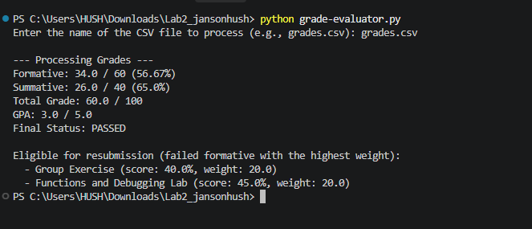
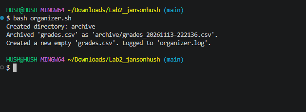

# Lab 2: ALU Transcript Generator

A Python application that calculates a student's final academic standing from a CSV file of course grades, plus a Bash script that archives the grades file and logs the action.

## Files

| File | Purpose |
|---|---|
| `grade-evaluator.py` | Validates grades and weights, calculates the GPA, decides PASSED or FAILED, and lists the assignments eligible for resubmission |
| `organizer.sh` | Archives `grades.csv` with a timestamp, creates a fresh empty `grades.csv`, and logs the action |
| `grades.csv` | Sample course data with the columns `assignment,group,score,weight` |
| `imgTest/` | Screenshots of the example runs shown in this README |

## Requirements

- Python 3 (standard library only: `csv`, `sys`, `os`, no external libraries)
- A Bash shell to run `organizer.sh` (Git Bash on Windows)

## How to run

### 1. Grade evaluator

```
python grade-evaluator.py
```

When asked, type the name of the CSV file (for example `grades.csv`).

Example run:

```
Enter the name of the CSV file to process (e.g., grades.csv): grades.csv

--- Processing Grades ---
Formative: 34.0 / 60 (56.67%)
Summative: 26.0 / 40 (65.0%)
Total Grade: 60.0 / 100
GPA: 3.0 / 5.0
Final Status: PASSED

Eligible for resubmission (failed formative with the highest weight):
  - Group Exercise (score: 40.0%, weight: 20.0)
  - Functions and Debugging Lab (score: 45.0%, weight: 20.0)
```

Both failed Formative assignments carry the same highest weight (20), so both are listed.



### 2. Organizer

```
bash organizer.sh
```

Example run:

```
Created directory: archive
Archived 'grades.csv' as 'archive/grades_20261113-222136.csv'.
Created a new empty 'grades.csv'. Logged to 'organizer.log'.
```



What it does:

1. Creates the `archive/` folder if it does not exist.
2. Moves `grades.csv` into `archive/` as `grades_YYYYMMDD-HHMMSS.csv`.
3. Creates a new, empty `grades.csv` in the current folder.
4. Appends a line to `organizer.log` with the timestamp, the original file name and the archived file name. The log grows with every run, for example:

```
[20261113-222136] Archived 'grades.csv' -> 'archive/grades_20261113-222136.csv'
```

## Rules implemented

- **Grade validation:** every score must be between 0 and 100.
- **Weight validation:** all weights add up to exactly 100, the Formative weights to 60, and the Summative weights to 40.
- **GPA:** `GPA = (Total Grade / 100) * 5.0`, where each assignment contributes `score * weight / 100`.
- **Pass or fail:** the student PASSES only with at least 50% in both categories (Formative: 30 out of 60, Summative: 20 out of 40).
- **Resubmission:** among the failed Formative assignments (score below 50), the one with the highest weight is eligible. If several share the highest weight, all of them are listed.

## Error handling

The program prints a clear message instead of crashing when:

- the file does not exist or the file name is blank
- the file is empty or has only the header row
- a score or weight is not a number, or a row is incomplete (the line number is shown)
- a score is outside 0 to 100, or a weight is negative
- the weights do not add up to 100, 60 and 40
- the group is not `Formative` or `Summative`

Example:

```
Error: Invalid weights.
  - Total weight is 90.0, expected 100.
```

## Testing

The results were cross-checked against the provided transcript (`ALU_Transcript.xlsx`, sheets `Transcript` and `v1` to `v6`). The status, GPA and resubmission list matched on all of them, for example:

| Case | GPA | Status | Resubmission |
|---|---|---|---|
| v2 | 3.83 | PASSED | Discussion Board, General Quiz (tie on weight) |
| v4 | 3.1575 | FAILED | None |
| v5 | 2.1075 | FAILED | General Quiz (highest weight among the failed) |
| v6 | 1.835 | FAILED | Group Coding Lab |

## Note

`organizer.sh` empties `grades.csv` after archiving it. Run `grade-evaluator.py` first, and put the grades back into `grades.csv` before evaluating again.
